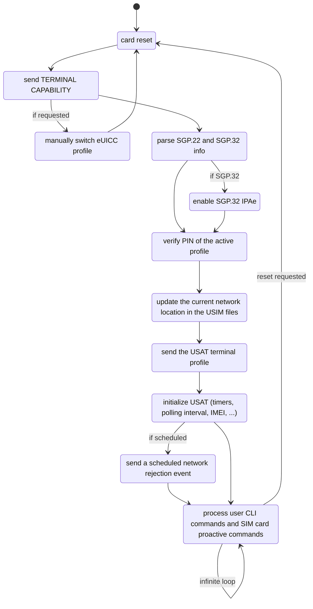

BIP modem emulator for eUICC testing
------------

The main intent is for testing SGP.32 eUICCs (eSIMs) with an embedded IoT Profile Agent (IPAe). SGP.32 is the IoT counterpart to the usual SGP.22 consumer eSIM standard.

Instead of the terminal equipment scanning an activation QRCode then talking to the operator's server in order to retrieve the profile, a SGP.32 eUICC with IPAe will do that on its own as long as the modem provides the adequate SIMToolkit/Card Application Toolkit/USIM Application Toolkit functionality.

This program emulates a cellular modem using a real SIM card, and provides all the necessary CAT/USAT functions expected by the SIM, including Bearer Independent Protocol channels so the SIM can get internet access.

This program uses a TUI (Terminal User Interface). The screen is split in two: the top part is the output log, and the bottom part is the input field for the command-line.

## Program startup flow

## Command-line arguments

* `--mcc`: mobile country code, 3 digits
* `--mnc`: mobile network code, 2 or 3 digits
* `--imei`: IMEI of the simulated mobile equipment
* `-p, --pin`: PIN code of the SIM/profile (warning: on an eUICC the same PIN will be used to unlock all profiles that require a PIN code; disable the PIN code first if that is not what you want)
* `-n, --network`: one of `none`, `2G`, `3G`, `4G`, `5G`; initial network attachment state
* `-r, --reader`: index of the smartcard reader to use, or `list` for a list of readers, or `auto` for auto-selection.

## Command descriptions

The commands are:
* [exit](#exit)
* [help](#help)
* [network](#network)
* [profile](#profile)
* [reset](#reset)
* [poll](#poll)

Each command and subcommand can take the `-h` argument in order to print its help text.

### `exit`

This simply exits the program.

### `help`

This prints the list of commands.

### `network`

Manage the cellular network as seen by the SIM.

Subcommands:
* [status](#network-status)
* [connect](#network-connect)
* [disconnect](#network-disconnect)
* [reject](#network-reject)

#### `network status`

This prints the currently attached network, which is one of:
* disconnected
* 2G (GERAN)
* 3G (UTRAN)
* 4G (E-UTRAN)
* 5G (NG-RAN)

The support for the various network types depends on the SIM card and the currently activated profile for an eUICC; not all SIM cards do support 5G for instance.

The operator (MCC and MNC) as well as the currently attached cell is also printed if the network is not disconnect. 

#### `network connect`

This command simulates an attachment to the network after having been disconnected.

#### `network disconnect`

This command simulates a disconnection from the network.

#### `network reject`

This command simulates a network rejection event. It is possible to wait until after a profile change before sending the event.

This is useful for testing either fallback/rollback mechanism of an eUICC:
* Make sure to be connected to the network
* Use the command `network reject --after-profile-state-change`
* Trigger a profile switch from the eIM, granting the rollback mechanism (or not)
* Wait until the profile switch happens, then the network rejection event will be sent
* Observe that the eUICC is falling back to its bootstrap profile (or another profile with the fallback attribute), or to the previous profile if rollback happens

### `profile`

Manage profiles on a SGP.22/SGP.32 eUICC.

Subcommands:
* [list](#profile-list)
* [switch](#profile-switch)

#### `profile list`

List some information about the profiles on the eUICC. The list of profiles is read at reset so it might not be up to date if a new profile was installed on the eUICC since then.

#### `profile switch`

Switch to another profile, given by its ICCID. The target profile must be disabled.

### `reset`

Reset the UICC, which triggers a re-reading of the SGP.22/SGP.32 information and the list of profiles.

A reset will automatically happen if the SIM card requests one, for instance if there was a profile switch triggered by the eIM on a SGP.32 eUICC.

### `poll`

Ask a Thales IPAe to poll for changes (this will cause the IPAe to go contact the eIM soon-ish). This is only for Thales SGP.32 eUICCs and the local APDU polling must be enabled (the Polling local interface setting must be set to `ENABLED_BY_APDU_AND_STK_MENU` or `ENABLED_BY_APDU`).
